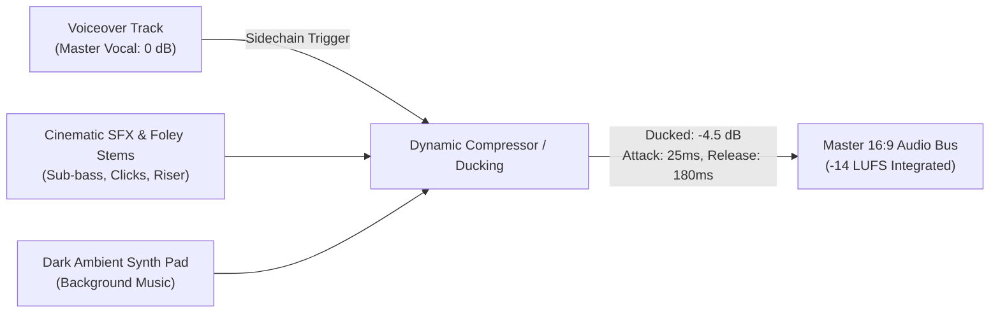

# Don Aurelius Sound Design & Audio Synchronization Map

High-retention cinematic audio synchronization specification for the 60-second Don Aurelius 16:9 tutorial video. Synchronized to 30 FPS Remotion timeline (1,800 total frames), engineered to accompany `tutorial_voiceover.mp3` (`en-US-ChristopherNeural`), and mixed for institutional clarity.

---

## 🎧 Audio Engineering Baseline Constants
- **Master Target Loudness:** -14 LUFS integrated (True Peak: -1.0 dBFS)
- **Sample Rate / Bit Depth:** 48,000 Hz / 24-bit PCM Stereo
- **Voiceover Priority:** Master dialogue centered at 0.0 dB (ducking ambient track by -4.5 dB via dynamic sidechain)
- **Stereo Spatialization:** 100% stereo width on atmospheric risers; discrete mono-point sources for tactile UI interactions

---

## ⏱️ Master Audio Synchronization Timeline

| Scene | Frame Range | Timecode | Visual Event / 16:9 Anchor | Primary SFX Layer | Secondary Micro-Texture | Target dB / Frequency Profile |
| :--- | :--- | :--- | :--- | :--- | :--- | :--- |
| **Scene 1: Sovereign Brand Emblem** | **0 – 105** | `0:00.0 – 0:03.5` | Macro tracking shot on monolithic obsidian block; 24kt gold emblem reveal. | **Cinematic Sub-Bass Rumble & Braam Drop** (40 Hz sub-impact) | **Sharp Metallic Specular Sweep** (Specular shimmer on gold bevels) | Primary: `-6.0 dB` (30–65 Hz) Sweep: `-12.0 dB` (8–14 kHz) |
| **Scene 2: Module Extraction & Topology** | **105 – 435** | `0:03.5 – 0:14.5` | Translucent glass archive block fractures open; gold-edged script layers drift out. | **Crisp Glass Suction & Air-Release Swoosh** (Pneumatic vault decompress) | **Subtle Crystalline Glass Ticks** (Fine resonant crystal clicks) | Primary: `-9.0 dB` (250–1,200 Hz) Clicks: `-16.0 dB` (3.5–7 kHz) |
| **Scene 3: MT5 IPC Handshake & Flow** | **435 – 1050** | `0:14.5 – 0:35.0` | Glassmorphic terminal logs scroll; MT5 Algo toggle switch flips to Imperial Gold (`#F5D061`). | **Low-Volume Mechanical Keyboard Typing Clacks** (Rapid buffered keystrokes) | **Tactile Metallic Toggle Switch Click** (Solid relay snap at frame 540) | Clacks: `-18.0 dB` (1.5–4 kHz) Switch: `-8.0 dB` (800 Hz transient) |
| **Scene 4: Holographic Demo Safety Shield** | **1050 – 1800** | `0:35.0 – 1:00.0` | Monolithic vault card introduces `ACCOUNT_MODE = DEMO`; spring zoom at frame 1050. | **Electronic Sci-Fi Shield Activation Ring** (Harmonic forcefield pulse) | **Heavy Electromagnetic Clamp Thud** (Vault risk limiter lock at frame 1290) | Ring: `-7.5 dB` (2.2–5.5 kHz) Thud: `-5.0 dB` (60–120 Hz) |

---

## 🎼 Scene-by-Scene Audio Directions

### Scene 1: Frames 0 – 105 (0:00.0 – 0:03.5)
- **Primary Sound Element:** Heavy cinematic sub-bass rumble and braam impact.
  - *Trigger:* Frame 0 (instant onset on first frame).
  - *Description:* Deep, controlled sub-bass impact settling into a low atmospheric drone (40–60 Hz) that establishes gravitational weight and luxury authority.
- **Secondary Sound Element:** Sharp metallic specular sweep.
  - *Trigger:* Frame 35 (peak glare on 24kt gold emblem).
  - *Description:* High-frequency brushed brass/gold friction whoosh with gentle reverb tail decaying by Frame 90 as voiceover cue delivers: *"Deploy institutional gold trading in sixty seconds."*
- **Spatial Positioning:** Sub-bass centered (Mono); metallic sweep pans subtly Left-to-Center (`L15 -> C`).

---

### Scene 2: Frames 105 – 435 (0:03.5 – 0:14.5)
- **Primary Sound Element:** Crisp glass suction / pneumatic air-release swoosh.
  - *Trigger:* Frame 105 (instantaneous cut from Title scene).
  - *Description:* Clean pneumatic pressure equalization swoosh combined with an organic glass suction sound as the dark translucent container fractures open.
- **Secondary Sound Element:** Floating glass crystal resonance & ribbon slide.
  - *Trigger:* Frame 180 – 360.
  - *Description:* Delicate, airy high-register crystalline movements and subtle mechanical slide textures representing the deployment of `settings.py`, `order_manager.py`, and `main.py`.
- **Spatial Positioning:** Wide stereo spread (75% L/R separation) providing breathing room for the central voiceover narration.

---

### Scene 3: Frames 435 – 1050 (0:14.5 – 0:35.0)
- **Primary Sound Element:** Low-volume mechanical keyboard typing clacks.
  - *Trigger:* Frames 435 – 750 (active log stream sequence).
  - *Description:* Rhythmic, tactile typing sounds (lubricated mechanical tactile switches, Gateron/Cherry MX style) calibrated at low gain (`-18 dB`) to evoke live algorithmic command compilation without overpowering Christopher's narration.
- **Secondary Sound Element:** Heavy gold toggle switch relay snap.
  - *Trigger:* Frame 540 (visual toggle flip from gray to Imperial Gold `#F5D061`).
  - *Description:* High-mass physical industrial toggle switch snap with an acoustic click and brief micro-hum indicating active IPC connection to MetaTrader 5.
- **Spatial Positioning:** Centered with slight right-ear bias (`R20`) aligning with the toggle switch placement on screen.

---

### Scene 4: Frames 1050 – 1800 (0:35.0 – 1:00.0)
- **Primary Sound Element:** Electronic sci-fi shield activation ring.
  - *Trigger:* Frame 1050 (exact spring scale-in of the `ACCOUNT_MODE = DEMO` card).
  - *Description:* Resonant, shimmering electromagnetic harmonic ring (2.4 kHz sine shimmer with fast pitch-rise and sustained crystalline decay) conveying absolute capital protection and prop-firm safety.
- **Secondary Sound Element:** Vault-lock circuit clamp thud & outro tail.
  - *Trigger:* Frame 1290 (risk limits lock) and Frame 1740 (outro cutoff).
  - *Description:* Deep acoustic clamp thud as risk thresholds (5% loss limit, 1.84% daily drawdown) click into place, resolving into a smooth low-frequency fade to black at Frame 1800.
- **Spatial Positioning:** Centered punch with wide holographic stereo chorus (`3D binaural effect`).

---

## 🎛️ Dynamic Sidechain & Ducking Specification

1. **Sidechain Compressor Settings:**
   - **Threshold:** `-22.0 dBFS`
   - **Ratio:** `3.5:1`
   - **Attack Time:** `25 ms` (smooth non-jarring attenuation)
   - **Release Time:** `180 ms` (natural audio return between sentences)
   - **Gain Reduction:** `-4.5 dB` on BGM / `-3.0 dB` on Foley during spoken dialogue
2. **Frequency Slotting:**
   - **Christopher Voiceover:** Centered around `120 Hz – 4.5 kHz`.
   - **Sub-bass & Braams:** Confined strictly to `< 85 Hz`.
   - **UI & Mechanical Clicks:** Notched at `2.8 kHz` and `8–12 kHz` to prevent masking vocal sibilance.
